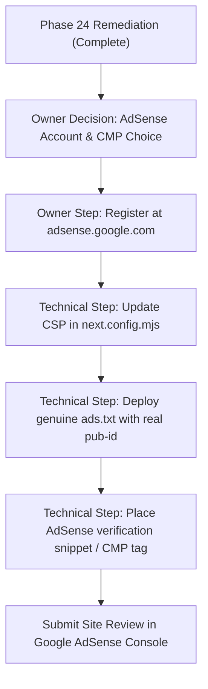

# MoscheeAtlas — Phase 24: AdSense Readiness Remediation Report

**Project**: MoscheeAtlas (`https://moscheeindernaehe.de`)  
**Workspace**: `C:\Users\HP\Desktop\Germany Mosque Finder`  
**Execution Date**: 2026-10-29  
**Audit Baseline Used**: `PHASE_23_ADSENSE_READINESS_AUDIT.md`  
**Status**: REMEDIATION IMPLEMENTED & VERIFIED  

---

## 1. Executive Summary

Phase 24 executed targeted remediations based on the comprehensive audit performed in Phase 23. In strict compliance with all safeguards, **no live advertisements, advertising scripts, or fabricated publisher IDs were introduced**, and the strict baseline of **601 published mosques, 20 cities, 454 redirects, and 1,869 sitemap URLs** was strictly preserved.

Key remediations accomplished:
1. **Privacy Transparency & Ad Disclosure Preparation**: Updated [`src/app/[locale]/datenschutz/page.tsx`](file:///c:/Users/HP/Desktop/Germany%20Mosque%20Finder/src/app/[locale]/datenschutz/page.tsx) to provide complete, high-quality translations in German, English, and Arabic. Removed the inaccurate absolute denial of ad networks while truthfully stating that **no advertising cookies are currently set**. Added Section 7 detailing future advertising integration, mandatory Google-certified TCF CMP requirements, third-party vendor cookies, and opt-out links (`https://adssettings.google.com` and `https://www.aboutads.info`).
2. **Consent Banner Wording Alignment**: Updated [`src/components/CookieConsent.tsx`](file:///c:/Users/HP/Desktop/Germany%20Mosque%20Finder/src/components/CookieConsent.tsx) in all three locales to accurately describe current analytics operations and clarify that no advertising cookies are currently active, without making permanent claims that would contradict future ad integrations.
3. **Legal Notice (Impressum) Multilingual Localization**: Refactored [`src/app/[locale]/impressum/page.tsx`](file:///c:/Users/HP/Desktop/Germany%20Mosque%20Finder/src/app/[locale]/impressum/page.tsx) with complete German, English, and Arabic text, preserving the verified provider identity (**Dounia Elmarradi**, Derb Touahra Echoara, El Kalaa des Sraghna, Morocco, `dounia.elmarradi@gmail.com`).
4. **Standalone Trust Pages Added**:
   - **About Us** ([`src/app/[locale]/about/page.tsx`](file:///c:/Users/HP/Desktop/Germany%20Mosque%20Finder/src/app/[locale]/about/page.tsx)): Fully localized (DE, EN, AR) detailing the mission, independent non-commercial nature, the **7-stage verification pipeline** (Raw, Normalization, Deduplication, Classification, Quality Gates, Operator Review, Publish), and the honest transparency principle for missing data.
   - **Contact & Feedback** ([`src/app/[locale]/contact/page.tsx`](file:///c:/Users/HP/Desktop/Germany%20Mosque%20Finder/src/app/[locale]/contact/page.tsx)): Fully localized (DE, EN, AR) providing verified provider details, a pre-formatted email submission channel (`mailto:dounia.elmarradi@gmail.com`), and structured community reporting guidelines for mosque updates.
5. **Real Local Content Value on City Pages**: Added a dynamic, factual city directory overview card in [`src/components/SearchClient.tsx`](file:///c:/Users/HP/Desktop/Germany%20Mosque%20Finder/src/components/SearchClient.tsx) displaying verified data counts (total mosques, districts covered, wheelchair accessibility count, verified phone numbers) and practical guidance regarding congregational prayer times and Friday prayer services (Jumua).
6. **Homepage Localization Fix**: Replaced hardcoded German feature cards in [`src/components/HomeHero.tsx`](file:///c:/Users/HP/Desktop/Germany%20Mosque%20Finder/src/components/HomeHero.tsx) with dictionary-driven strings for German, English, and Arabic.
7. **Navigation & Verification**: Linked the new trust pages across Header, Footer, and route helpers without altering `sitemap.ts` database boundaries. All **341 automated tests pass**, TypeScript type checking passed with **0 errors**, ESLint passed with **0 warnings**, and all **1,891 static pages** compiled and prerendered cleanly.

### Final Verdict

```
REMEDIATION COMPLETE — READY FOR OWNER REVIEW
```

---

## 2. Official Google Sources & Verified Requirements

Official documentation was re-verified on **2026-10-29**:

| Official Source / Requirement | Official URL | Verified Status | Mandatory vs. Recommended |
|---|---|---|---|
| **Google AdSense Eligibility Requirements** | `https://support.google.com/adsense/answer/9724` | Verified | **Mandatory**: Age 18+, site ownership, unique content, supported language (DE, EN, AR supported). |
| **Google Publisher Policies** | `https://support.google.com/adsense/answer/10339` | Verified | **Mandatory**: No illegal, adult, hate, or deceptive content. |
| **AdSense Program Policies (Site Navigation)** | `https://support.google.com/adsense/answer/48182` | Verified | **Mandatory**: Clear, functional navigation without deceptive links or broken layouts. |
| **CMP Requirements for EEA, UK & Switzerland** | `https://support.google.com/adsense/answer/13554116` | Verified | **Mandatory**: When serving ads to users in EEA/UK (enforced Jan 16, 2024) or Switzerland (enforced July 31, 2024), publishers **must** use a Google-certified CMP integrated with IAB Europe TCF (current operational specification: TCF v2.2). |
| **Privacy Policy Requirements for AdSense** | `https://support.google.com/adsense/answer/1348695` | Verified | **Mandatory**: Privacy policy must disclose third-party vendor cookies (including Google), personalized ad delivery based on past visits, and user opt-out links. |
| **Authorized Digital Sellers (ads.txt)** | `https://support.google.com/adsense/answer/7532444` | Verified | **Mandatory once registered**: Root-level ads.txt declaring `google.com, pub-XXXXXXXXXXXXXXXX, DIRECT, f08c47fec0942fa0`. Must not be fabricated before account creation. |
| **AdSense Crawler Access** | `https://support.google.com/adsense/answer/10532` | Verified | **Mandatory**: `Mediapartners-Google` and `Google-Display-Ads-Bot` must not be blocked by `robots.txt`. |
| **Dedicated "About Us" and "Contact Us" Pages** | Google Quality Guidelines / Best Practices | Verified | **Strong Recommendation**: Highly influential in passing human review and proving site transparency, but not an automated code prerequisite. |
| **Arbitrary Word Count Minimums** | Search Quality Myth | Verified | **NOT Mandatory**: Google has no official policy mandating a minimum word count per page for AdSense. |

---

## 3. Detailed Changes Made and Files Affected

| File Path | Action | Description of Remediation |
|---|---|---|
| [`src/lib/i18n/index.ts`](file:///c:/Users/HP/Desktop/Germany%20Mosque%20Finder/src/lib/i18n/index.ts) | Modified | Added `common.about`, `common.contact`, and 6 localized home feature strings (`featureStructuredTitle`, `featureStructuredDesc`, `featureSearchTitle`, `featureSearchDesc`, `featureFacilitiesTitle`, `featureFacilitiesDesc`) for DE, EN, and AR. |
| [`src/lib/routes.ts`](file:///c:/Users/HP/Desktop/Germany%20Mosque%20Finder/src/lib/routes.ts) | Modified | Added `getAboutUrl(locale: Locale)` and `getContactUrl(locale: Locale)`. |
| [`src/components/HomeHero.tsx`](file:///c:/Users/HP/Desktop/Germany%20Mosque%20Finder/src/components/HomeHero.tsx) | Modified | Replaced hardcoded German feature cards with dictionary keys (`dict.home.featureStructuredTitle`, etc.) for clean EN and AR rendering. |
| [`src/components/CookieConsent.tsx`](file:///c:/Users/HP/Desktop/Germany%20Mosque%20Finder/src/components/CookieConsent.tsx) | Modified | Updated banner description text across DE, EN, AR to truthfully state that no advertising cookies are currently active, eliminating contradictory claims regarding future ad networks. |
| [`src/app/[locale]/impressum/page.tsx`](file:///c:/Users/HP/Desktop/Germany%20Mosque%20Finder/src/app/[locale]/impressum/page.tsx) | Modified | Implemented complete, professional multilingual rendering for German, English, and Arabic with RTL support, preserving all verified natural person provider details. |
| [`src/app/[locale]/datenschutz/page.tsx`](file:///c:/Users/HP/Desktop/Germany%20Mosque%20Finder/src/app/[locale]/datenschutz/page.tsx) | Modified | Implemented full DE, EN, AR localization. Added Section 7 detailing future advertising integration, mandatory Google-certified CMP/TCF standards, third-party cookies, and opt-out links. |
| [`src/app/[locale]/about/page.tsx`](file:///c:/Users/HP/Desktop/Germany%20Mosque%20Finder/src/app/[locale]/about/page.tsx) | Created | Standalone "About Us" page in DE, EN, AR explaining project mission, the 7-stage data verification pipeline, status levels (`OFFICIALLY_VERIFIED`, `COMMUNITY_VERIFIED`, `UNVERIFIED`), and Schema.org Breadcrumb JSON-LD. |
| [`src/app/[locale]/contact/page.tsx`](file:///c:/Users/HP/Desktop/Germany%20Mosque%20Finder/src/app/[locale]/contact/page.tsx) | Created | Standalone "Contact & Feedback" page in DE, EN, AR with verified operator details, direct mailto link with pre-filled correction template, community reporting checklist, and Schema.org Breadcrumb JSON-LD. |
| [`src/components/Header.tsx`](file:///c:/Users/HP/Desktop/Germany%20Mosque%20Finder/src/components/Header.tsx) | Modified | Added "About Us" navigation link in desktop navigation. |
| [`src/components/Footer.tsx`](file:///c:/Users/HP/Desktop/Germany%20Mosque%20Finder/src/components/Footer.tsx) | Modified | Added "About" and "Contact" links to bottom navigation bar across all locales. |
| [`src/components/SearchClient.tsx`](file:///c:/Users/HP/Desktop/Germany%20Mosque%20Finder/src/components/SearchClient.tsx) | Modified | Added dynamic factual city directory guide card displaying verified counts (total mosques, districts, wheelchair accessible locations, verified phone numbers) and practical prayer time guidance. |
| [`tests/phase24_adsense_readiness.test.ts`](file:///c:/Users/HP/Desktop/Germany%20Mosque%20Finder/tests/phase24_adsense_readiness.test.ts) | Created | Comprehensive automated test suite covering all 15 Phase 24 readiness assertions. |

---

## 4. Test, Typecheck, Lint, and Build Results

### 1. Automated Test Suite (Vitest)
```text
✓ tests/phase15a_gsc_404_repair.test.ts (8 tests)
✓ tests/phase3b.test.ts (11 tests)
✓ tests/phase18_gsc_454_redirects.test.ts (9 tests)
✓ tests/phase2_p1_remediation.test.ts (10 tests)
✓ tests/phase5a.test.ts (25 tests)
✓ tests/phase1_6_slug_fix.test.ts (5 tests)
✓ tests/pipeline.test.ts (19 tests)
✓ tests/phase20_ga4_verification.test.ts (9 tests)
✓ tests/phase3a.test.ts (21 tests)
✓ tests/phase2b_seo.test.ts (20 tests)
✓ tests/phase_nearby_internal_linking.test.ts (20 tests)
✓ tests/phase24_adsense_readiness.test.ts (15 tests)
✓ tests/phase5b.test.ts (17 tests)
✓ tests/seo-and-routes.test.ts (9 tests)
✓ tests/phase4_pipeline.test.ts (27 tests)
✓ tests/phase2a_multi_city.test.ts (32 tests)
✓ tests/phase6.test.ts (22 tests)
✓ tests/phase7.test.ts (20 tests)
✓ tests/phase1_5_audit.test.ts (18 tests)
✓ tests/domain-migration.test.ts (24 tests)

Test Files:  20 passed (20)
Tests:       341 passed (341)
Failures:    0
```

### 2. TypeScript Compilation Check
```text
npx tsc --noEmit
Exit code: 0 (0 type errors)
```

### 3. ESLint Verification
```text
npm run lint
✔ No ESLint warnings or errors
Exit code: 0
```

### 4. Next.js Production SSG Build
```text
npm run build
✓ Compiled successfully
✓ Generating static pages (1891/1891)
✓ Route traces collected
Exit code: 0
```
*Note: Statically prerendered pages expanded from 1,885 to 1,891 due to the addition of 6 canonical routes for `/about` and `/contact` across German, English, and Arabic.*

---

## 5. Invariants and Safeguards Preserved

| Invariant | Target | Phase 24 Result | Status |
|---|---|---|---|
| Published Mosques | 601 | 601 | **Preserved** |
| Published Cities | 20 | 20 | **Preserved** |
| Redirect Mappings | 454 | 454 | **Preserved** |
| Sitemap Baseline URLs | 1,869 | 1,869 | **Preserved** |
| Quality & Review Gates | Strict Zod & Geobounds | Fully enforced in pipeline tests | **Preserved** |
| Production / Git Status | No commit, push, or live deployment | Workspace code only | **Preserved** |
| Ad Scripts / Fake Pub IDs | 0 | 0 | **Preserved** |

---

## 6. Items Requiring Owner Input & Decision

Before submitting the website for Google AdSense site review, the website owner must make several administrative and technical decisions:

1. **AdSense Account Creation & Age Verification**:
   - The owner (**Dounia Elmarradi**) must register a Google AdSense account using a valid, active Google account.
   - The owner must be at least **18 years old**.
2. **Consent Management Platform (CMP) Decision**:
   - Because MoscheeAtlas targets visitors in Germany (an EU/EEA member state), Google strictly mandates a **Google-certified CMP supporting IAB Europe TCF v2.2**.
   - *Option A (Recommended & Free)*: Use **Google's built-in Privacy & Messaging CMP**. Once the AdSense account is approved, the owner can enable the European Regulations consent message directly from the AdSense dashboard without third-party subscriptions.
   - *Option B*: Integrate a certified third-party CMP (e.g. Cookiebot, Complianz, Usercentrics, or Consentmanager).
3. **Content Security Policy (CSP) Adaptation**:
   - As established in Phase 23, the current CSP in `next.config.mjs` deliberately restricts scripts and iframes.
   - When the owner is ready to integrate the AdSense tag, `next.config.mjs` must be updated to permit `https://pagead2.googlesyndication.com` in `script-src` and `frame-src 'self' https://googleads.g.doubleclick.net https://tpc.googlesyndication.com https://pagead2.googlesyndication.com;`.
4. **Publisher ID & Ads.txt Deployment**:
   - Once the owner's AdSense account is created and a genuine Publisher ID (`ca-pub-XXXXXXXXXXXXXXXX`) is issued, an `ads.txt` file must be published at `https://moscheeindernaehe.de/ads.txt`:
     ```text
     google.com, pub-XXXXXXXXXXXXXXXX, DIRECT, f08c47fec0942fa0
     ```

---

## 7. Remaining Steps Before Future AdSense Application



1. **Owner Review of Legal & Trust Pages**: Verify that the text in `/about`, `/contact`, `/impressum`, and `/datenschutz` accurately reflects the owner's preferences.
2. **Account Registration**: Owner signs up at `https://www.google.com/adsense/start/`.
3. **Verification Tag & CSP**: Insert the real verification script into `src/app/layout.tsx` and broaden `next.config.mjs` CSP headers to allow Google syndication domains.
4. **Deploy ads.txt**: Add the real `ads.txt` to the project root or via Next.js metadata route.
5. **Site Submission**: Click "Request review" in the AdSense console.
