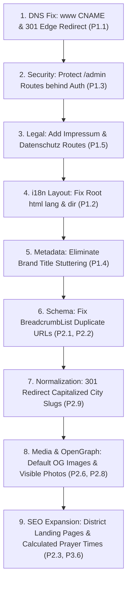

# MoscheeAtlas — Phase 1: Comprehensive SEO Audit Report
**Production Domain:** [https://moscheeindernaehe.de](https://moscheeindernaehe.de)  
**Brand:** MoscheeAtlas  
**Date of Audit:** October 9, 2026  
**Auditor:** Antigravity AI Engineering & Technical SEO Pair  
**Status:** READ-ONLY Forensic Audit Completed (Zero Code / Dataset / Config Mutations)

---

## 1. Executive Summary

A comprehensive, evidence-based SEO and technical architecture audit of **MoscheeAtlas** (`https://moscheeindernaehe.de`) was performed. The investigation encompassed source code inspection, test suite execution (288 automated tests passed across 15 test suites), and direct HTTP verification against the live production infrastructure hosted on Railway Hikari.

### Overall SEO Readiness
- **Readiness Rating:** **B+ (Technically Sound Foundation with Critical Edge Defects)**
- **Indexation Health:** The core architecture is fundamentally healthy. The canonical domain migration from `moscheeatlas.de` to `moscheeindernaehe.de` was executed cleanly with zero residual references in production source code (`src/`). The sitemap accurately lists all 1,674 valid canonical URLs with zero 404s, zero unpromoted cities, and zero non-canonical origins.
- **Blockers Identified:** Zero P0 critical blockers prevent site crawling. However, **five P1 high-priority defects** require prompt remediation:
  1. Complete DNS resolution failure for the `www` subdomain (`www.moscheeindernaehe.de`).
  2. Document-level `<html lang="de">` hardcoding across English and Arabic routes with nested RTL assignment.
  3. Unauthenticated public exposure of internal admin and data quality reporting routes (`/admin` and `/[locale]/admin`).
  4. Brand title tag stuttering/duplication across homepages (`MoscheeAtlas – ... | MoscheeAtlas`).
  5. Absence of legally required Impressum (§ 5 TMG) and Datenschutzerklärung (GDPR) on a German `.de` domain running active Google Analytics.

---

## 2. Verified Production Baseline

All baseline metrics were empirically verified against the repository filesystem and live HTTP endpoints:

| Baseline Attribute | Target Baseline | Verified Repository State | Verification Method & File Reference |
| :--- | :--- | :--- | :--- |
| **Published Mosque Records** | 542 | **542** | Verified in [`src/data/mosques.json`](file:///c:/Users/HP/Desktop/Germany%20Mosque%20Finder/src/data/mosques.json) (`dataStatus: "PUBLISHED"`) |
| **Verification Status** | 100% UNVERIFIED | **542 (100% UNVERIFIED)** | Zero records have artificial `OFFICIALLY_VERIFIED` status in [`src/data/mosques.json`](file:///c:/Users/HP/Desktop/Germany%20Mosque%20Finder/src/data/mosques.json) |
| **Raw Entity Database Total** | 594 | **594** | Verified in [`src/data/all-entities.json`](file:///c:/Users/HP/Desktop/Germany%20Mosque%20Finder/src/data/all-entities.json) (542 Published, 47 Reviewed, 5 Rejected) |
| **Published Cities** | 14 | **14** | Berlin, Dortmund, Düsseldorf, Essen, Frankfurt, Hamburg, Köln, München, Stuttgart, Bremen, Wuppertal, Bonn, Nürnberg, Leipzig in [`src/pipeline/city-config.ts`](file:///c:/Users/HP/Desktop/Germany%20Mosque%20Finder/src/pipeline/city-config.ts) & [`src/data/city-registry-overrides.json`](file:///c:/Users/HP/Desktop/Germany%20Mosque%20Finder/src/data/city-registry-overrides.json) |
| **Candidate / Review Cities** | Excluded | **Excluded (404)** | Hannover, Dresden, Duisburg return HTTP 404 and are excluded from sitemap |
| **Canonical Sitemap URLs** | 1,674 | **1,674** | 3 Home + 3 Search Hubs + 42 City Collections + 1,626 Detail pages in live [`sitemap.xml`](file:///c:/Users/HP/Desktop/Germany%20Mosque%20Finder/src/app/sitemap.ts) |
| **Canonical Origin** | `https://moscheeindernaehe.de` | **100% Consistent** | 1,674 of 1,674 URLs start with `https://moscheeindernaehe.de/`. Zero `moscheeatlas.de` references. |
| **Automated Test Suite** | All Passing | **288 Passed (15 files)** | Verified via `vitest run` on Node v22.15.0 |

---

## 3. Findings Classification (P0 – P3)

### Priority P0: Critical Fatal Blockers
*None detected.* The production site is accessible, responds over HTTPS, delivers status 200 on all valid canonical URLs, emits no 5xx server errors, and is not globally blocked by `robots.txt`.

---

### Priority P1: High Priority (Critical SEO / Technical / Legal Defects)

#### [P1.1] DNS Resolution Failure for `www` Subdomain (Missing CNAME / A Record)
- **Classification:** Confirmed Defect (Infrastructure / DNS)
- **Code Reference:** DNS Infrastructure / Railway Hikari Edge
- **Reproduction:**
  ```bash
  curl.exe -I https://www.moscheeindernaehe.de
  # Result: getaddrinfo ENOTFOUND www.moscheeindernaehe.de
  ```
- **Impact:** Any user typing `www.moscheeindernaehe.de` or external webmasters linking with `www.` receives a browser connection failure ("Server IP address could not be found"). This results in lost backlinks, degraded domain authority transfer, and broken user journeys.
- **Remediation:** Add a DNS CNAME record for `www` pointing to `moscheeindernaehe.de` (or the Railway host) with an edge 301 redirect from `https://www.moscheeindernaehe.de` to `https://moscheeindernaehe.de`.

#### [P1.2] Root Document Language Hardcoded to German `<html lang="de">` Across All Locales
- **Classification:** Confirmed Defect (Core Template)
- **Code Reference:** [`src/app/layout.tsx#L45`](file:///c:/Users/HP/Desktop/Germany%20Mosque%20Finder/src/app/layout.tsx#L45) & [`src/app/[locale]/layout.tsx#L33`](file:///c:/Users/HP/Desktop/Germany%20Mosque%20Finder/src/app/%5Blocale%5D/layout.tsx#L33)
- **Live Evidence:**
  - `curl -s https://moscheeindernaehe.de/en` outputs `<html lang="de">` followed by `<div lang="en" dir="ltr">`.
  - `curl -s https://moscheeindernaehe.de/ar` outputs `<html lang="de">` followed by `<div lang="ar" dir="rtl">`.
- **Impact:** Search engine crawlers (Googlebot, Bingbot) and screen readers evaluate the `lang` attribute on the root `<html>` tag. Declaring `lang="de"` on English and Arabic pages causes crawler language-detection conflicts, impairs hreflang relevance in foreign language SERPs, and misconfigures assistive screen readers. Additionally, `dir="rtl"` applied only to a nested `<div>` impairs native browser RTL scrolling and form rendering.
- **Remediation:** Restructure Next.js App Router layout so that `<html>` and `<body>` are rendered within `src/app/[locale]/layout.tsx` (or passed dynamically via route params), applying `<html lang={locale} dir={locale === 'ar' ? 'rtl' : 'ltr'}>` at the root document level.

#### [P1.3] Public Unauthenticated Exposure of Administrative & Data Quality Routes
- **Classification:** Confirmed Security & Data Exposure Defect
- **Code Reference:** [`src/app/[locale]/admin/page.tsx`](file:///c:/Users/HP/Desktop/Germany%20Mosque%20Finder/src/app/%5Blocale%5D/admin/page.tsx) & [`src/app/admin/page.tsx`](file:///c:/Users/HP/Desktop/Germany%20Mosque%20Finder/src/app/admin/page.tsx)
- **Live Evidence:**
  - `https://moscheeindernaehe.de/admin` returns HTTP 307 redirecting to `/de/admin`.
  - `https://moscheeindernaehe.de/de/admin` returns **HTTP 200 OK** to any anonymous visitor.
- **Impact:** While `robots.txt` disallows `/admin` and `/*/admin`, and `robots: { index: false, follow: false }` is set in page metadata, robots rules do not prevent human access or scraping by malicious bots. The page displays raw pipeline diagnostics, rejection reasons (flagged spam/clubs), unverified review queues, and internal curation metadata.
- **Remediation:** Restrict `/admin` and `/*/admin` behind server-side authentication (e.g. Next.js middleware checking a session token or HTTP Basic Auth) or return a 404 in production environments when unauthenticated.

#### [P1.4] Brand Name Stuttering / Duplication in Homepage Title Tags
- **Classification:** Confirmed Defect (SEO Metadata)
- **Code Reference:** [`src/app/layout.tsx#L9-L12`](file:///c:/Users/HP/Desktop/Germany%20Mosque%20Finder/src/app/layout.tsx#L9-L12) & [`src/app/[locale]/page.tsx#L27`](file:///c:/Users/HP/Desktop/Germany%20Mosque%20Finder/src/app/%5Blocale%5D/page.tsx#L27)
- **Live Evidence:**
  - Live `<head>` of `/de`: `<title>MoscheeAtlas – Finde eine Moschee in deiner Nähe | MoscheeAtlas</title>`
  - Live `<head>` of `/en`: `<title>MoscheeAtlas – Find a Mosque Near You in Germany | MoscheeAtlas</title>`
  - Live `<head>` of `/ar`: `<title>MoscheeAtlas – ابحث عن مسجد قريب في ألمانيا | MoscheeAtlas</title>`
- **Impact:** The root layout defines `title.template: '%s | MoscheeAtlas'`. Because `dict.seo.homeTitle` already starts with `MoscheeAtlas – ...`, the rendered title stutters with the brand name duplicated at both the start and end. Google SERPs may rewrite or truncate stuttering titles.
- **Remediation:** In `src/app/[locale]/page.tsx`, return `title: { absolute: dict.seo.homeTitle }` to bypass the template, or remove the brand prefix from `dict.seo.homeTitle`.

#### [P1.5] Missing Legally Mandated Impressum (§ 5 TMG) & Datenschutzerklärung (GDPR)
- **Classification:** Confirmed Legal & E-E-A-T Defect
- **Code Reference:** [`src/components/Footer.tsx`](file:///c:/Users/HP/Desktop/Germany%20Mosque%20Finder/src/components/Footer.tsx) & [`src/app/layout.tsx#L47-L58`](file:///c:/Users/HP/Desktop/Germany%20Mosque%20Finder/src/app/layout.tsx#L47-L58)
- **Live Evidence:**
  - Footer bottom bar only contains links to `Home`, `Berlin`, and `Search`.
  - Google Analytics (`G-XRV9JC90FT`) is loaded via `next/script` without a consent banner or Privacy Policy link.
- **Impact:** Under German telemedia law (§ 5 DDG / formerly TMG) and interstate media treaty (§ 18 MStV), any commercial or organized public directory operating on a `.de` domain targeting Germany must provide an easily recognizable, directly accessible, and permanently available Impressum. Furthermore, running Google Analytics without a Privacy Policy (Datenschutzerklärung) violates GDPR Art. 13 and risks administrative fines (Abmahnung) while failing Google's E-E-A-T quality evaluation.
- **Remediation:** Add dedicated `/impressum` and `/datenschutz` routes (with locale alternates) and link them prominently in the footer.

---

### Priority P2: Medium Priority (Structural & Schema Deficiencies)

#### [P2.1] Duplicate Target URL in Detail Page BreadcrumbList Schema
- **Classification:** Confirmed Schema Defect
- **Code Reference:** [`src/components/MosqueDetailView.tsx#L78-L80`](file:///c:/Users/HP/Desktop/Germany%20Mosque%20Finder/src/components/MosqueDetailView.tsx#L78-L80)
- **Live Evidence:**
  ```json
  {
    "@type": "BreadcrumbList",
    "itemListElement": [
      { "@type": "ListItem", "position": 1, "name": "Home", "item": "https://moscheeindernaehe.de/de" },
      { "@type": "ListItem", "position": 2, "name": "Deutschland", "item": "https://moscheeindernaehe.de/de" },
      { "@type": "ListItem", "position": 3, "name": "Berlin", "item": "https://moscheeindernaehe.de/de/moscheen/berlin" }
    ]
  }
  ```
- **Impact:** Positions 1 ("Home") and 2 ("Deutschland") contain the identical URL (`/de`). Schema.org and Google Search Central guidelines require each breadcrumb item to represent a distinct step in the hierarchy. Duplicate URLs can trigger schema warnings or cause Google to discard breadcrumb rich snippets.
- **Remediation:** Align detail page breadcrumbs with city page breadcrumbs: Position 1 = Home (`/de`), Position 2 = Deutschland / Bundesland (`/de/moscheen`), Position 3 = City (`/de/moscheen/berlin`).

#### [P2.2] Detail Breadcrumb Schema Links to Robots-Disallowed District Query Parameter
- **Classification:** Confirmed Crawl / Indexation Inconsistency
- **Code Reference:** [`src/components/MosqueDetailView.tsx#L81-L83`](file:///c:/Users/HP/Desktop/Germany%20Mosque%20Finder/src/components/MosqueDetailView.tsx#L81-L83) & [`src/app/robots.ts#L17`](file:///c:/Users/HP/Desktop/Germany%20Mosque%20Finder/src/app/robots.ts#L17)
- **Live Evidence:** When a mosque has a district (e.g. Bad Cannstatt), position 4 item is:
  `item: "https://moscheeindernaehe.de/de/moscheen/stuttgart?district=Bad%20Cannstatt"`
  While `robots.txt` explicitly specifies: `Disallow: /*?*district=`.
- **Impact:** Structured data directs Googlebot to a URL that the server's own `robots.txt` instructs it not to crawl. Furthermore, the city page canonical strips the district parameter.
- **Remediation:** Either remove query parameters from BreadcrumbList schema items or introduce dedicated, indexable district routes.

#### [P2.3] Absence of Dedicated Indexable District Landing Pages (`moscheen in [stadtteil]`)
- **Classification:** Keyword Architecture & Intent Defect
- **Code Reference:** [`src/app/[locale]/moscheen/[city]/page.tsx`](file:///c:/Users/HP/Desktop/Germany%20Mosque%20Finder/src/app/%5Blocale%5D/moscheen/%5Bcity%5D/page.tsx)
- **Impact:** Queries such as *"Moschee Neukölln"*, *"Moschee Kreuzberg"*, *"Moschee Köln Ehrenfeld"* represent high-intent local German searches. Currently, district filters are executed purely as client-side parameters (`?district=...`) that are blocked by robots and canonicalized to the city page. The directory has **0 rankable pages** for German city districts.
- **Remediation:** Implement static or dynamic district collection routes (e.g., `/de/moscheen/[city]/[district]`) for major districts with 3+ published mosques, with dedicated canonicals and inclusion in the sitemap.

#### [P2.4] Detail Page Title Truncation (85% Exceed 60 Characters)
- **Classification:** SERP Display Risk
- **Code Reference:** [`src/app/[locale]/moschee/[city]/[slug]/page.tsx#L50`](file:///c:/Users/HP/Desktop/Germany%20Mosque%20Finder/src/app/%5Blocale%5D/moschee/%5Bcity%5D/%5Bslug%5D/page.tsx#L50)
- **Empirical Evidence:** In `src/data/mosques.json`, 461 out of 542 detail page titles (85.1%) exceed 60 characters, and 234 (43.2%) exceed 75 characters when formatted as `[seoTitle] | MoscheeAtlas`.
  - Example: `Interkulturelles Zentrum für Dialog und Bildung e.V. IZDB – Moschee in Berlin (13359) | MoscheeAtlas` (95 characters).
- **Impact:** Search engines truncate long titles with ellipses (`...`), cutting off the city name or brand in SERP snippets.
- **Remediation:** Shorten title templates for long entity names, prioritizing: `[Short Name] – Moschee [City] | MoscheeAtlas`.

#### [P2.5] Unstructured Opening Hours String in Schema.org JSON-LD
- **Classification:** Schema Quality & Rich Results Risk
- **Code Reference:** [`src/lib/seo/schema.ts#L52`](file:///c:/Users/HP/Desktop/Germany%20Mosque%20Finder/src/lib/seo/schema.ts#L52)
- **Live Evidence:** Outputs `"Mo 9 AM to 10 PM"`, `"Tu 9 AM to 10:30 PM"`.
- **Impact:** Schema.org standard format for `openingHours` requires days of the week followed by 24-hour time ranges (e.g. `Mo 09:00-22:00` or `Mo-Su 09:00-22:30`) or structured `openingHoursSpecification`. Raw strings from Google Maps may cause Rich Result parsing warnings in Google Search Console.
- **Remediation:** Parse opening hours into standard 24-hour notation or `OpeningHoursSpecification` objects with `dayOfWeek`, `opens`, and `closes`.

#### [P2.6] Missing Social Sharing Card Images (`og:image`) on Homepage, Search, and City Hubs
- **Classification:** Social Metadata Defect
- **Code Reference:** [`src/app/layout.tsx`](file:///c:/Users/HP/Desktop/Germany%20Mosque%20Finder/src/app/layout.tsx), [`src/app/[locale]/page.tsx`](file:///c:/Users/HP/Desktop/Germany%20Mosque%20Finder/src/app/%5Blocale%5D/page.tsx), [`src/app/[locale]/moscheen/[city]/page.tsx`](file:///c:/Users/HP/Desktop/Germany%20Mosque%20Finder/src/app/%5Blocale%5D/moscheen/%5Bcity%5D/page.tsx)
- **Evidence:** Detail pages pass `mosque.imageUrl` to `openGraph.images`, but homepage, search pages, and city collection pages pass no image property. Root layout has no default fallback `og:image`.
- **Impact:** Shared links on WhatsApp, Facebook, LinkedIn, and Twitter display without an image card, severely depressing click-through rates.
- **Remediation:** Generate an OpenGraph banner image (e.g. `/images/og-default.jpg`) and declare it in root metadata.

#### [P2.7] Complete Absence of OpenGraph Metadata on Search Hub Routes
- **Classification:** Incomplete Social Metadata
- **Code Reference:** [`src/app/[locale]/moscheen/page.tsx`](file:///c:/Users/HP/Desktop/Germany%20Mosque%20Finder/src/app/%5Blocale%5D/moscheen/page.tsx) & [`src/app/[locale]/mosques/page.tsx`](file:///c:/Users/HP/Desktop/Germany%20Mosque%20Finder/src/app/%5Blocale%5D/mosques/page.tsx)
- **Evidence:** `generateMetadata` in both search routes returns only `title`, `description`, and `alternates`. Zero `openGraph` properties are defined.
- **Remediation:** Add complete `openGraph` configuration to both search page metadata generators.

#### [P2.8] Mosque Photos Stored in Database Are Not Rendered in the Visible DOM
- **Classification:** Content Presentation & Image SEO Defect
- **Code Reference:** [`src/components/MosqueDetailView.tsx`](file:///c:/Users/HP/Desktop/Germany%20Mosque%20Finder/src/components/MosqueDetailView.tsx) & [`src/components/MosqueCard.tsx`](file:///c:/Users/HP/Desktop/Germany%20Mosque%20Finder/src/components/MosqueCard.tsx)
- **Evidence:** Over 500 records contain a valid `imageUrl` in `src/data/mosques.json`. However, neither `MosqueDetailView.tsx` nor `MosqueCard.tsx` renders an `` or `<Image>` tag with `mosque.imageUrl`. Additionally, `streetviewpixels-pa.googleapis.com` is missing from `images.remotePatterns` in [`next.config.mjs`](file:///c:/Users/HP/Desktop/Germany%20Mosque%20Finder/next.config.mjs).
- **Impact:** Google Image Search cannot index mosque photography, and user experience is diminished by the absence of visual mosque representations.
- **Remediation:** Render responsive, lazy-loaded mosque images with descriptive alt attributes on detail pages and card previews, and add Google Street View thumbnail domains to `next.config.mjs`.

#### [P2.9] Strict Case-Sensitivity Causes 404 on Capitalized City Routes
- **Classification:** URL Normalization Defect
- **Code Reference:** [`src/app/[locale]/moscheen/[city]/page.tsx#L97`](file:///c:/Users/HP/Desktop/Germany%20Mosque%20Finder/src/app/%5Blocale%5D/moscheen/%5Bcity%5D/page.tsx#L97)
- **Live Evidence:**
  - `curl -I https://moscheeindernaehe.de/de/moscheen/Berlin` -> **HTTP 404 Not Found**
  - Code strictly checks: `if (city !== cityConfig.slug) notFound();`
- **Impact:** In German, city names are proper nouns capitalized by default. Users typing `/Berlin` or legacy backlinks with capital letters receive a 404 error rather than a canonical 301/308 redirect to `/berlin`.
- **Remediation:** If `normalizeCitySlug(city) === cityConfig.slug` but `city !== cityConfig.slug`, issue a permanent redirect (`redirect(canonicalPath, RedirectType.replace)`) instead of `notFound()`.

---

### Priority P3: Low Priority (Optimizations & Cleanliness)

#### [P3.1] Duplicate Search Navigation Links in Desktop Header
- **Code Reference:** [`src/components/Header.tsx#L58-L70`](file:///c:/Users/HP/Desktop/Germany%20Mosque%20Finder/src/components/Header.tsx#L58-L70)
- **Evidence:** Header renders two adjacent links:
  1. `<Link href={getSearchUrl(locale)}><span>Moscheen finden</span></Link>`
  2. `<Link href={getSearchUrl(locale)}><span>Suchen</span></Link>`
- **Remediation:** Consolidate into a single clear primary navigation link (e.g. "Moscheen suchen").

#### [P3.2] Duplicate City Links in Footer Columns
- **Code Reference:** [`src/components/Footer.tsx#L41-L80`](file:///c:/Users/HP/Desktop/Germany%20Mosque%20Finder/src/components/Footer.tsx#L41-L80)
- **Evidence:** Column 2 ("Moscheen nach Stadt") iterates `getPublishedCityConfigs()` (14 cities). Column 3 ("Beliebte Städte") iterates the exact same `getPublishedCityConfigs()` (14 cities).
- **Remediation:** Differentiate Column 3 to link to Bundesländer (federal states) or high-volume city search hubs rather than duplicating the identical 14 links.

#### [P3.3] Missing `xhtml:link` Multilingual Alternates in XML Sitemap
- **Code Reference:** [`src/app/sitemap.ts`](file:///c:/Users/HP/Desktop/Germany%20Mosque%20Finder/src/app/sitemap.ts)
- **Evidence:** `sitemap.xml` returns 1,674 flat `<url>` entries with `<loc>` and `<lastmod>`, but does not include `<xhtml:link rel="alternate" hreflang="..." />` blocks.
- **Impact:** While HTML `<head>` tags provide hreflang, Google Search Console processes language clustering significantly faster when cross-language alternates are also declared in the XML sitemap.
- **Remediation:** Add `alternates: { languages: { de: ..., en: ..., ar: ... } }` to Next.js `sitemap.ts` entries.

#### [P3.4] Root URL `/` Emits HTTP 307 Temporary Redirect Instead of HTTP 308 Permanent Redirect
- **Code Reference:** [`src/app/page.tsx#L4`](file:///c:/Users/HP/Desktop/Germany%20Mosque%20Finder/src/app/page.tsx#L4)
- **Live Evidence:** `curl.exe -I https://moscheeindernaehe.de/` returns `HTTP/1.1 307 Temporary Redirect`.
- **Impact:** Search engines interpret 307 as temporary and may retain the root `/` URL in the crawl queue rather than consolidating PageRank permanently onto the `/de` canonical route.
- **Remediation:** Configure permanent redirect via `next.config.mjs` async redirects (`permanent: true`) or `redirect('/de', RedirectType.replace)`.

#### [P3.5] Hardcoded German Value Proposition Cards on English and Arabic Homepages
- **Code Reference:** [`src/components/HomeHero.tsx#L235-L262`](file:///c:/Users/HP/Desktop/Germany%20Mosque%20Finder/src/components/HomeHero.tsx#L235-L262)
- **Evidence:** Headings "Strukturierte Einträge", "Präzise Lokale Suche", and "Ausstattungsangaben" are static German strings, displaying in German on `/en` and `/ar`.
- **Remediation:** Move card copy into `src/lib/i18n/index.ts` dictionaries.

#### [P3.6] Prayer Times Search Intent Expectation Gap
- **Code Reference:** [`src/app/layout.tsx#L14`](file:///c:/Users/HP/Desktop/Germany%20Mosque%20Finder/src/app/layout.tsx#L14) & [`src/lib/i18n/index.ts#L121`](file:///c:/Users/HP/Desktop/Germany%20Mosque%20Finder/src/lib/i18n/index.ts#L121)
- **Observation:** Meta descriptions promise "mit Gebetszeiten und Ausstattung", but detail pages show a disclaimer: *"Gebetszeiten werden nur angezeigt, wenn sie direkt von der Gemeinde verifiziert wurden. Bitte vor Ort oder telefonisch erfragen."*
- **Recommendation:** While preserving data integrity by never fabricating unverified mosque timetables, satisfy search intent for `gebetszeiten moschee [stadt]` by integrating calculated solar prayer times (e.g. Adhan library configured with DITIB/Islamrat parameters), explicitly labeled as astronomical reference times.

---

## 4. Keyword & Landing Page Architecture Analysis

### Evaluation of German Keyword Clusters

| Keyword Intent Cluster | Current URL / Architecture | SERP Relevance & Intent Match | Identified Gaps & Cannibalization Risks |
| :--- | :--- | :--- | :--- |
| **`moschee in der nähe`** | Homepage (`/de`) | **High**. Hero title, geolocation button, and meta description directly address proximity search. | Stuttering title tag (`MoscheeAtlas – ... | MoscheeAtlas`). Missing explicit local schema on homepage. |
| **`moschee in [stadt]`** | City Collections (`/de/moscheen/[stadt]`) | **Very High**. Covers all 14 published cities with direct counts, verified addresses, and interactive maps. | Capitalized slugs (e.g. `/Berlin`) return 404 instead of 301 redirect. Missing Bundesland breadcrumb link. |
| **`moscheen in [stadtteil]`** | Filter on City Page (`?district=...`) | **Zero Indexable Surface**. District parameter is disallowed in `robots.txt` and canonicalized away. | **Complete blind spot**. High-volume district queries cannot rank due to absence of indexable district URLs. |
| **`freitagsgebet in [stadt]`** | No dedicated landing page or content | **Unaddressed**. Only appears in raw entity names. | High-intent weekly search query completely unserved. |
| **`gebetszeiten moschee [stadt]`** | Detail pages & City pages | **Partial / Frustrated Intent**. Promised in SERP snippets but absent on landing pages. | Snippet expectation mismatch; users bouncing after seeing disclaimer notice. |

---

## 5. Indexation and Content Quality Verification

- **Sitemap Purity:** Verified. 0 reviewed/rejected entities enter the sitemap. 0 candidate cities (Hannover, Dresden, Duisburg) enter the sitemap. All 1,674 entries represent live, published pages.
- **Thin Content Protection:** Verified. Cities with 0 published records return 404 and cannot generate indexable thin pages.
- **Affiliation Integrity:** Verified. No organization affiliation (DITIB, IGMG, VIKZ, ATIB, Ahmadiyya) is ever inferred from mosque names alone. All affiliations require verified official domain provenance.
- **Facility Truthfulness:** Verified. Unknown facility fields are rendered as `"Keine Angabe"` (No info) rather than `"false"` / `"Nein"`.
- **Third-Party Copyright Safety:** Verified. Zero third-party review text or reviewer names are copied or stored in the database. Only aggregate numerical star ratings and total review counts are displayed.
- **Arabic RTL Quality:** Partially deficient. While Arabic text is grammatically translated, document-level `<html lang="de">` prevents proper browser-level RTL layout engine activation.

---

## 6. Verification Status of All Checks

### Confirmed by Direct Live HTTP Probing
- [x] Apex domain HTTP to HTTPS redirection (301 to `https://moscheeindernaehe.de/`)
- [x] Subdomain `www.moscheeindernaehe.de` DNS failure (`ENOTFOUND`)
- [x] Root URL `/` 307 redirection to `/de`
- [x] Trailing slash normalization (308 redirect from `/de/` to `/de`)
- [x] City route locale enforcement (404 on `/de/mosques`, 404 on `/en/moscheen`)
- [x] Candidate city exclusion (404 on `/de/moscheen/hannover`, `/de/moscheen/dresden`)
- [x] Admin page public accessibility (200 on `/de/admin`)
- [x] Live sitemap parsing (exactly 1,674 URLs, 0 non-canonical origins)
- [x] Live robots.txt parsing (correct disallow rules and sitemap declaration)
- [x] Live HTML `<head>` tag extraction (canonical, hreflang reciprocity, OpenGraph, Twitter)
- [x] Live JSON-LD extraction (`@type: Mosque`, `@type: BreadcrumbList`)
- [x] Security headers inspection (HSTS, CSP, X-Frame-Options, Referrer-Policy)

### Confirmed by Repository Source & Test Suite Inspection
- [x] Total database counts: 542 published, 47 reviewed, 5 rejected
- [x] 100% UNVERIFIED status across all 542 published records
- [x] Title length distribution: 461/542 titles exceed 60 characters
- [x] Absence of visible image rendering in `MosqueDetailView.tsx`
- [x] Passing status of all 288 Vitest tests across 15 test files

### Checks That Could Not Be Verified (Pending External Infrastructure Access)
- [ ] Google Search Console crawl stats and indexation coverage (requires GSC property access)
- [ ] Real-user Core Web Vitals (INP, LCP, CLS) from Chrome UX Report (requires CrUX dataset access)
- [ ] Actual keyword impressions, rankings, and click-through rates (requires live GSC search performance data)
- [ ] Railway production environment variables configuration (requires Railway dashboard access)

---

## 7. Recommended Phase 2 Remediation Order

Remediation should proceed strictly in order of risk and impact:



---

## 8. Google Search Console Launch Checklist

1. [x] **Meta Verification Token:** Present on root layout (`gn8N5OcGt0pLLpTALghRPXtJj31NPHB2UiK0uCZYCSI`).
2. [ ] **Domain Property Verification:** Verify domain-level property (`moscheeindernaehe.de`) via DNS TXT record in addition to URL prefix verification.
3. [ ] **Sitemap Submission:** Submit `https://moscheeindernaehe.de/sitemap.xml` in GSC.
4. [ ] **Robots.txt Test:** Verify Googlebot accessibility in GSC Robots.txt Tester tool.
5. [ ] **Canonical URL Inspection:** Test representative URLs using URL Inspection Tool:
   - Homepage: `https://moscheeindernaehe.de/de`
   - City Page: `https://moscheeindernaehe.de/de/moscheen/koeln`
   - Mosque Page: `https://moscheeindernaehe.de/de/moschee/berlin/lubars-mosque`
6. [ ] **International Targeting:** Confirm hreflang clustering in GSC without missing return tag errors.
7. [ ] **Rich Results Test:** Run Google Rich Results Test on representative detail page to validate `@type: Mosque` and `@type: BreadcrumbList`.
8. [ ] **Index Jumpstart:** Request indexing for the 14 core city collection pages to accelerate discovery of all 542 mosque detail pages.
